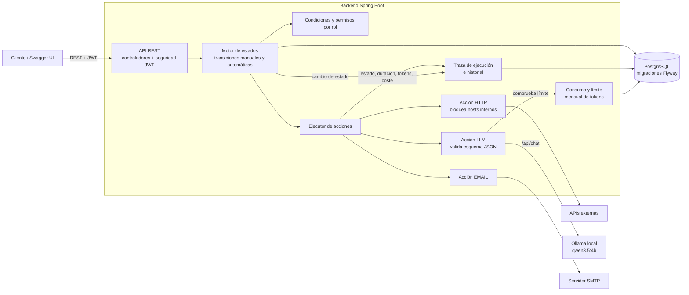

# flowState-backend

[](https://github.com/mgl120-ua/flowState-backend/actions/workflows/ci.yml)

API REST para la gestión de flujos de trabajo y estados con autenticación JWT.

## El problema

Bancos y aseguradoras quieren usar IA en tareas repetitivas, como clasificar reclamaciones o revisar documentación KYC. Pero en un sector regulado no basta con que el modelo acierte casi siempre. Hay que poder explicar cada decisión, saber qué datos se enviaron al modelo, impedir que una respuesta mal formada cambie el estado de un expediente y saber cuánto se está gastando. Si el LLM se conecta directamente al proceso, ninguna de esas preguntas tiene respuesta: el modelo decide y nadie puede reconstruir por qué ni con qué límites.

## Qué hace FlowState

FlowState modela cada proceso como una máquina de estados, con estados, transiciones, condiciones y permisos por rol. La IA es una acción más dentro del flujo y no es quien lo gobierna.

- **La IA propone.** Una acción `LLM` envía al modelo un prompt con datos del expediente (`{{cliente}}`, `{{descripcion}}`…) y le exige una respuesta JSON que cumpla un esquema (`outputSchema`).
- **El motor valida y decide.** El backend vuelve a validar la respuesta contra el esquema. Si no es JSON válido, no cumple el esquema o se corta por `maxTokens`, la acción falla y la transición se deshace entera (estado, historial y datos). El cambio de estado lo decide una condición explícita, por ejemplo `clasificacion.body.tipo == 'cargo_no_reconocido' or clasificacion.body.confianza < 0.7`, que manda el caso a una cola de revisión prioritaria aunque el modelo no lo pida. Las transiciones manuales solo las ejecuta un rol con permiso sobre esa transición.
- **Todo queda registrado.** Cada acción deja una traza en PostgreSQL con su estado, duración y error. En las acciones LLM se guarda también el modelo, los tokens de entrada y salida, el coste, el prompt enviado (recortado a 8 KB) y el motivo de fin. Las ejecuciones fallidas se guardan igualmente, en una transacción aparte, aunque la transición se deshaga. El historial de la instancia registra cada cambio de estado y quién lo hizo, o si lo hizo el sistema.
- **El gasto tiene límite.** Cada empresa puede fijar un límite mensual de tokens. Al alcanzarlo, las acciones LLM fallan sin llamar al modelo hasta el mes siguiente. `GET /usage/llm` muestra llamadas, tokens y coste por modelo y por flujo.

Los modelos se ejecutan en local con Ollama (`qwen3.5:4b` por defecto), sin claves ni coste por llamada.

### Estado actual

| Implementado | Previsto |
|---|---|
| Flujos, estados, transiciones manuales y automáticas con condiciones | Llamadas al LLM asíncronas (hoy van dentro de la petición) |
| Acciones HTTP, EMAIL y LLM, con plantillas sobre los datos de la instancia | Proveedor Azure OpenAI además de Ollama |
| Validación de la salida del LLM con JSON Schema | Paso de consulta normativa con RAG sobre regulación bancaria pública |
| Traza de ejecución con modelo, tokens, coste y prompt | Evaluaciones con casos etiquetados (acierto, citas, coste, latencia) |
| Límite mensual de tokens y consumo por empresa | Demo desplegada con Docker en Azure |
| Empresas, roles, permisos por transición, registro por invitación, JWT | |

## Arquitectura



## Descripción

Este proyecto es un backend Spring Boot que implementa:

- Autenticación y autorización con JWT
- Gestión de usuarios, roles y permisos
- Control de flujos de trabajo (`Workflow`, `State`, `Transition`)
- Ejecución de transiciones/instancias con validación de condiciones
- Integración con PostgreSQL
- Documentación OpenAPI / Swagger

## Tecnologías

- Java 21
- Spring Boot 3.4.4
- Spring Web
- Spring Data JPA
- Spring Security
- PostgreSQL
- Swagger / Springdoc OpenAPI
- JJWT para JWT
- Lombok
- JUnit + Spring Boot Test

## Requisitos

- Java 21
- Maven (se usa el wrapper incluido `./mvnw.cmd`)
- PostgreSQL

## Configuración

La configuración principal se encuentra en `src/main/resources/application.properties`.

Variables de entorno requeridas:

- `SPRING_DATASOURCE_PASSWORD` - contraseña de la base de datos PostgreSQL
- `SPRING_MAIL_PASSWORD` - contraseña del servicio SMTP
- `JWT_SECRET` - clave secreta para firmar JWT

Variables opcionales:

- `FLOWSTATE_HTTP_ALLOW_PRIVATE_HOSTS` - `true` permite que las acciones HTTP llamen a direcciones internas (`localhost`, redes privadas). Por defecto `false`; actívalo solo para pruebas locales
- `FLOWSTATE_LLM_PROVIDER` - proveedor de las acciones LLM: `ollama` (por defecto) o `fake` (respuestas fijas, sin modelo)
- `FLOWSTATE_LLM_OLLAMA_URL` - URL de Ollama. Por defecto `http://localhost:11434`
- `FLOWSTATE_LLM_DEFAULT_MODEL` - modelo si la acción no indica uno. Por defecto `qwen3.5:4b`

Perfiles de Spring disponibles:

- `local`
- `prod`

Puedes seleccionar el perfil con:

```powershell
$env:SPRING_PROFILES_ACTIVE="local"
./mvnw.cmd spring-boot:run
```

## Base de datos

La URL de conexión por defecto es:

```text
jdbc:postgresql://localhost:5432/flowState
```

Asegúrate de crear la base de datos y el usuario con los permisos necesarios antes de ejecutar la aplicación.

El esquema se gestiona con Flyway: al arrancar, la aplicación aplica las migraciones de `src/main/resources/db/migration` y Hibernate solo valida que las entidades coinciden (`ddl-auto=validate`). Con el perfil `local` se cargan además los datos de ejemplo de `src/main/resources/db/demo`.

Para cambiar el esquema, añade un nuevo archivo `V<n>__descripcion.sql` en `db/migration`; no modifiques las migraciones ya aplicadas.

Si tienes una base de datos creada antes de usar Flyway, recréala vacía (con Docker: `docker compose down -v`) para que las migraciones se apliquen desde cero.

## Cómo ejecutarlo

### 1. Modelo local con Ollama

Las acciones LLM necesitan [Ollama](https://ollama.com) en la máquina anfitriona con un modelo pequeño:

```powershell
ollama pull qwen3.5:4b   # una vez, unos 3,3 GB
ollama serve             # si no está ya arrancado como servicio
```

En un portátil sin GPU conviene que Ollama tenga un solo modelo cargado y atienda una petición cada vez (ver [Aprendizaje sobre el hardware](#aprendizaje-sobre-el-hardware)):

```powershell
$env:OLLAMA_MAX_LOADED_MODELS="1"
$env:OLLAMA_NUM_PARALLEL="1"
```

### 2a. Con Docker (backend + PostgreSQL)

Las credenciales se leen de un archivo `.env` que no se sube al repositorio:

```powershell
Copy-Item .env.example .env   # y rellena los valores
docker compose up --build
```

| Variable de `.env` | Obligatoria | Uso |
|---|---|---|
| `POSTGRES_USER`, `POSTGRES_PASSWORD` | Sí | Usuario y contraseña de PostgreSQL |
| `POSTGRES_DB` | No (`flowState`) | Nombre de la base de datos |
| `JWT_SECRET` | Sí | Clave para firmar los JWT, de al menos 32 caracteres |
| `SPRING_MAIL_PASSWORD` | No | Contraseña SMTP. Hace falta para ejecutar transiciones manuales, que envían un email de aviso |
| `FLOWSTATE_LLM_OLLAMA_URL` | No | URL de Ollama vista desde el contenedor. Por defecto `http://host.docker.internal:11434` |

Si falta alguna variable obligatoria, `docker compose` se detiene indicando cuál. La API queda en `http://localhost:8085` y Swagger en `http://localhost:8085/swagger-ui.html`.

### 2b. Sin Docker

Con PostgreSQL en `localhost:5432` y la base de datos `flowState` creada (ver [Base de datos](#base-de-datos)):

```powershell
$env:SPRING_DATASOURCE_USERNAME="tu-usuario"   # por defecto, marta
$env:SPRING_DATASOURCE_PASSWORD="..."
$env:JWT_SECRET="..."                           # al menos 32 caracteres
$env:SPRING_MAIL_PASSWORD="..."
$env:SPRING_PROFILES_ACTIVE="local"             # opcional: carga datos de ejemplo
./mvnw.cmd spring-boot:run
```

El resto de variables están en [Configuración](#configuración).

### Sin modelo

Para probar los flujos sin Ollama, arranca sin Docker con `FLOWSTATE_LLM_PROVIDER=fake`: las acciones LLM devuelven la respuesta fija que indique cada acción (`fakeResponse` y `fakeRules`).

## Registro de usuarios

- `POST /auth/register/admin` crea una empresa nueva y su usuario administrador (rol `ADMIN`).
- Los empleados solo pueden registrarse con una invitación. Un `ADMIN` la crea con `POST /invitations` (`roleId` de un rol de su empresa y, opcionalmente, el `email` del invitado) y comparte el `code` devuelto. El empleado se registra con `POST /auth/register/employee` enviando `name`, `email`, `password` e `invitationCode`.
- Cada invitación sirve una sola vez y caduca a los 7 días. `GET /invitations` lista las de la empresa y `DELETE /invitations/{id}` revoca una.

## Acciones y transiciones automáticas

Las acciones se ejecutan al pasar por una transición. Las gestiona un `ADMIN` y pertenecen a su empresa.

- `POST /actions` crea una acción (`name`, `type`, `config`). `GET`, `PUT` y `DELETE /actions/{id}` la consultan, editan o borran.
- `POST /flows/{flowId}/transitions/{transitionId}/actions` asocia una acción a una transición (`actionId` y `position`, que fija el orden). `DELETE .../actions/{actionId}` la desasocia.
- `GET /flows/{flowId}/instances/{instanceId}/executions` devuelve la traza de las acciones ejecutadas en una instancia (estado, código HTTP, duración y error; en las acciones LLM también modelo, tokens, coste, prompt y motivo de fin).

Tipos de acción:

- `EMAIL`: `{"to", "subject", "body"}`.
- `HTTP`: `{"method", "url", "headers", "body", "timeoutMs", "saveAs"}`. Solo `url` es obligatoria; el método por defecto es `GET` y el timeout 10 s (máximo 30 s). Si se indica `saveAs`, la respuesta se guarda en los datos de la instancia como `{"status": 200, "body": ...}`. Se considera fallo cualquier respuesta que no sea 2xx.
- `LLM`: `{"model", "system", "prompt", "outputSchema", "maxTokens", "timeoutMs", "saveAs"}`. Solo `prompt` es obligatorio; `maxTokens` es 1024 por defecto (máximo 8192) y el timeout 120 s (máximo 300 s). Con `outputSchema` (JSON Schema) el modelo debe responder un JSON que lo cumpla, y el backend lo vuelve a validar. Si se indica `saveAs`, se guarda `{"status": "ok", "body": ...}`. Es fallo una respuesta que no cumple el esquema, que se corta por `maxTokens` o que no llega.

En `url`, cabeceras, cuerpo, los campos del email y el `prompt` y `system` de una acción LLM se pueden usar variables con los datos de la instancia: `{{cliente}}` o `{{validacion.body.id}}`.

### Acciones LLM con Ollama

Las acciones LLM usan modelos abiertos que se ejecutan en tu máquina con [Ollama](https://ollama.com): no hace falta clave ni tienen coste.

```powershell
ollama pull qwen3.5:4b   # una vez, unos 3,3 GB
ollama serve             # si no está ya arrancado como servicio
```

Ejemplo de clasificación de reclamaciones por comisiones bancarias, que guarda el resultado en `data.clasificacion` (el esquema completo está en [`demo/reclamaciones/esquema-clasificacion.json`](demo/reclamaciones/esquema-clasificacion.json)):

```json
{
  "name": "Clasificar reclamación",
  "type": "LLM",
  "config": {
    "system": "Eres analista de reclamaciones de clientes de un banco español...",
    "prompt": "Cliente: {{cliente}}\nProducto: {{producto}}\nReclamación: {{descripcion}}",
    "outputSchema": {
      "type": "object",
      "properties": {
        "tipo": {"type": "string", "enum": ["mantenimiento", "descubierto", "tarjeta", "cajero", "transferencia", "cargo_no_reconocido", "otra"]},
        "urgencia": {"type": "string", "enum": ["alta", "media", "baja"]},
        "procede_devolucion": {"type": "boolean"},
        "importe_reclamado": {"type": ["number", "null"], "minimum": 0},
        "confianza": {"type": "number", "minimum": 0, "maximum": 1},
        "motivo": {"type": "string"}
      },
      "required": ["tipo", "urgencia", "procede_devolucion", "importe_reclamado", "confianza", "motivo"],
      "additionalProperties": false
    },
    "maxTokens": 400,
    "saveAs": "clasificacion"
  }
}
```

Después, una transición automática con la condición `clasificacion.body.tipo == 'cargo_no_reconocido' or clasificacion.body.urgencia == 'alta' or clasificacion.body.confianza < 0.7` lleva la reclamación a revisión prioritaria, y otra con la condición `true` deja el resto en revisión ordinaria. La IA solo propone si procede la devolución: la deciden transiciones manuales que solo puede ejecutar el rol `GESTOR`.

Cada llamada queda en la traza con el modelo, los tokens de entrada y salida, el coste, el prompt enviado (recortado a 8 KB, puede contener datos de la instancia) y el motivo de fin. El coste sale de la tabla `flowstate.llm.prices` de `application.properties`; los modelos locales no están en ella y cuestan 0.

Para tests o demos sin Ollama, `FLOWSTATE_LLM_PROVIDER=fake` responde con lo que indique la propia acción: `"fakeResponse"` (respuesta por defecto) y `"fakeRules": [{"contains": "texto del prompt", "response": ...}]`.

Las cifras de latencia y memoria de cada modelo están en [Aprendizaje sobre el hardware](#aprendizaje-sobre-el-hardware). Un modelo tan pequeño puede equivocarse incluso con confianza alta, así que sus decisiones críticas deben pasar por una persona.

Consumo y límite (solo `ADMIN`, datos de su empresa):

- `GET /usage/llm?from=2026-10-01&to=2026-10-31` devuelve llamadas, tokens y coste en total, por modelo y por flujo, el límite mensual y lo consumido este mes. Sin fechas, el mes en curso.
- `PUT /companies/me/llm-limit` con `{"monthlyTokenLimit": 200000}` fija el límite mensual de tokens; `null` lo quita. Al alcanzarlo, las acciones LLM fallan sin llamar al modelo hasta el mes siguiente.

Una transición con `"automatic": true` la ejecuta el motor sin intervención al llegar a su estado origen, si se cumple su condición. Si hay varias, se ejecuta la primera que se cumpla (por orden de creación), y así sucesivamente hasta llegar a un estado `FINAL`, no tener ninguna aplicable o encadenar 20 seguidas. Las condiciones admiten rutas con punto, por ejemplo `validacion.body.ok == true`.

Si una acción falla, la transición se deshace por completo (estado, historial y datos), la API responde `502` indicando la acción y el motivo, y el fallo queda en la traza. Al crear una instancia también se ejecutan sus transiciones automáticas; si una falla, la instancia se queda en el estado inicial.

## Demo: reclamaciones por comisiones bancarias

[`demo/reclamaciones`](demo/reclamaciones) monta el caso completo contra la API:

1. Crea una entidad con un administrador y un usuario con rol `GESTOR`.
2. Define el flujo `Recibida → Clasificada → Revisión prioritaria | Revisión ordinaria → Devolución aprobada | Reclamación desestimada`.
3. Clasifica con el modelo local las cuatro reclamaciones de [`reclamaciones.json`](demo/reclamaciones/reclamaciones.json): una comisión de mantenimiento cobrada por error, una comisión de cajero que el cliente aceptó, unos cargos no reconocidos (posible fraude) y un descubierto ambiguo.
4. El administrador intenta resolver una reclamación y recibe `403`, porque solo el `GESTOR` tiene permiso. El gestor registra su decisión y una nota y aprueba o desestima cada una, coincida o no con lo que propuso la IA.
5. Muestra la traza de cada llamada al modelo (tokens, coste y duración), el historial de cambios de estado con quién los hizo y el consumo total.

```powershell
ollama pull qwen3.5:4b
./mvnw.cmd spring-boot:run          # en otra terminal, con las variables de entorno configuradas
powershell -ExecutionPolicy Bypass -File demo\reclamaciones\demo-reclamaciones.ps1
```

Cada reclamación de `reclamaciones.json` incluye la clasificación esperada, y el script cuenta cuántos campos acierta el modelo. Al ejecutar una transición manual el backend envía un email de aviso, así que hace falta `SPRING_MAIL_PASSWORD`.

## Métricas

| Métrica | Valor | Cómo se ha obtenido |
|---|---|---|
| Tests automáticos | 128, todos en verde | `./mvnw verify` con PostgreSQL 16 (JUnit 5 y Spring Boot Test, 27 clases de test) |
| Integración continua | GitHub Actions en cada push y pull request a `main` y `dev` | [`.github/workflows/ci.yml`](.github/workflows/ci.yml): Java 21, PostgreSQL 16 como servicio y `mvnw verify`, en torno a 1 minuto |
| Coste por llamada al LLM | 0 USD con modelos locales | Los modelos que no están en `flowstate.llm.prices` cuestan 0. Para un modelo de pago se indica el precio en USD por millón de tokens y la traza guarda el coste de cada llamada |
| Latencia por llamada | Unos 8 s con `qwen3.5:4b` | Portátil i7-1255U, 32 GB de RAM, solo CPU. La primera llamada tras arrancar Ollama tarda más porque carga el modelo (unos 24 s medidos con `qwen2.5:3b`) |
| Tokens por llamada en la demo | Pendiente de medir | El script de la demo muestra los tokens de cada llamada |
| Acierto del modelo en la demo | Pendiente de medir | El script compara cada clasificación con la esperada en `reclamaciones.json` |
| Límite mensual por empresa | Configurable, sin límite por defecto | `PUT /companies/me/llm-limit`. Se comprueba antes de cada llamada, así que la última llamada del mes puede superarlo ligeramente |

## Aprendizaje sobre el hardware

Todo el desarrollo se ha hecho en un portátil sin GPU dedicada (Intel i7-1255U, 32 GB de RAM), así que el modelo tenía que funcionar solo con CPU y compartir memoria con Windows, Docker, PostgreSQL, la JVM y el IDE.

- **`qwen3-coder:30b`: no viable.** Al cargarlo, el portátil dejó de responder. Aunque por cada token solo trabaja una parte del modelo, Ollama tiene que cargar en memoria los 30.000 millones de parámetros: con cuantización de 4 bits son del orden de 15-20 GB solo de pesos, a los que se suma el contexto. Con el resto del entorno abierto, el sistema se queda sin memoria y empieza a usar disco.
- **`qwen2.5:3b`: rápido pero poco fiable.** Ocupa unos 2,2 GB de RAM y responde en unos 7-8 s (unos 100 tokens de entrada y 30 de salida), pero clasificó mal el caso urgente de las pruebas.
- **`qwen3.5:4b`: el elegido.** Ocupa unos 3,7 GB de RAM, responde en unos 8 s y clasificó bien los tres casos de prueba, incluido el urgente. Se llama con `"think": false` para que no genere un razonamiento previo, que gasta tokens y alarga la respuesta.

Conclusiones:

- En un equipo así conviene no pasar de modelos de unos 4B parámetros y limitar Ollama a un modelo cargado (`OLLAMA_MAX_LOADED_MODELS=1`, `OLLAMA_NUM_PARALLEL=1`).
- Un modelo pequeño basta para proponer una clasificación con un esquema cerrado, siempre que el motor valide la respuesta y una persona revise las decisiones importantes.
- El modelo se elige por acción (`model`) o por variable de entorno, así que pasar a un modelo mayor o a un proveedor gestionado no cambia los flujos.

## Swagger / Documentación

Después de arrancar la aplicación, la documentación Swagger está disponible en:

```text
http://localhost:8085/swagger-ui.html
```

## Pruebas

Ejecuta las pruebas con:

```powershell
./mvnw.cmd test
```

El test que aplica las migraciones de Flyway sobre una base de datos real solo se ejecuta si existe `FLOWSTATE_TEST_DB_URL` (con `FLOWSTATE_TEST_DB_USER` y `FLOWSTATE_TEST_DB_PASSWORD`), como en la integración continua.

## Buenas prácticas de uso

- Nunca subas el valor de `JWT_SECRET` ni contraseñas al repositorio.
- Usa variables de entorno o un gestor de secretos para las credenciales.
- Revisa los perfiles `local` y `prod` antes de desplegar.

## Notas

Este repositorio contiene un servicio de backend para gestionar el ciclo de vida de instancias en un sistema de workflows, incluyendo control de permisos, condiciones de transición y auditoría de instancias.
